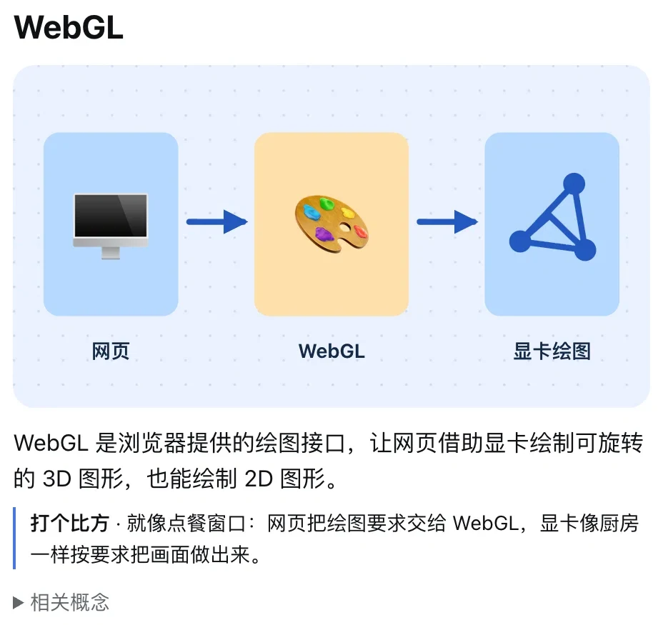

# DSH ELI5 Card

DeepSeek Harness 插件：在对话里选中一个不熟悉的词，点「解释」，就能生成带配图和类比的卡片。保存过的词和别名会在其他会话里高亮，点击可重新打开卡片。



*实际生成的 WebGL 卡片，截图只展示解释内容。*

## 安装

需要 DeepSeek Harness `0.2.2-rc.5` 至 `0.2.3` 之前的兼容版本，以及 Node.js 24 或更新版本。知识图谱需要 WebGL。

```sh
git clone https://github.com/holooooo/dsh-eli5-card.git
cd dsh-eli5-card
npm ci
npm run check
```

在 Harness 中打开 **插件 → 添加插件**，选择克隆后的 `dsh-eli5-card` 目录。若当前窗口尚未加载插件，重启 Harness。

## 使用

- **划词解释**：选中聊天里的词或短语并点「解释」。浮动卡片可拖动，支持追问，问答随卡片保存。
- **知识图谱**：从侧边栏打开 3D 图谱，拖动旋转、滚动缩放。节点足够大时显示名称；悬停预览，点击打开卡片，并可跳回来源会话。
- **图谱设置**：点图谱右上角的齿轮，选择跟随当前会话或固定模型，编辑解释提示词，或指定卡片库文件。
- **卡片库**：在 **内置插件 → 划词解释** 中搜索、删除卡片，查看和复制 Markdown 元数据，或下载带图解的 HTML。

## 存储与模型

卡片默认保存在 Harness 本地配置档的存储中。也可以填写一个位于现有目录中的绝对 `.json` 路径或 `~/…` 路径。新文件会复制当前卡片库；已有的有效卡片库会直接打开。不合并库，也不删除原文件。

生成解释时，插件会把选中的术语和有限的同轮可见文字发给所选模型。卡片库不保存那些会话摘录，但会保存用户提交的追问及模型回答。

## 验证

`npm run check` 构建客户端并运行单元测试。宿主集成测试使用 Harness 的 Cordis、Typert Gateway 和 JSON 存储，以及测试模型。当前版本的设置面板、图谱与追问尚未在重新加载后的桌面界面中验收。

实现与验证细节见 [插件文档](docs/DETAIL.md)。3D 图谱基于 [3d-force-graph](https://github.com/vasturiano/3d-force-graph)。
